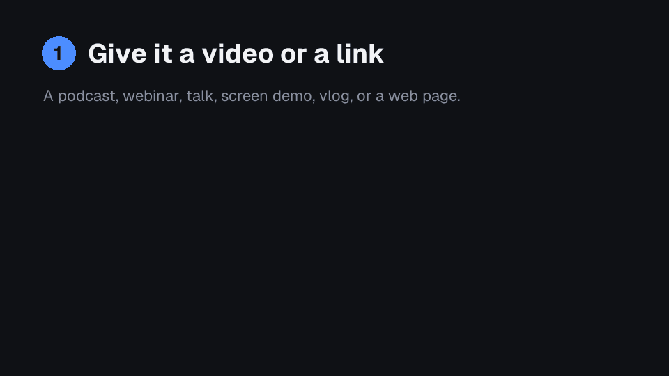
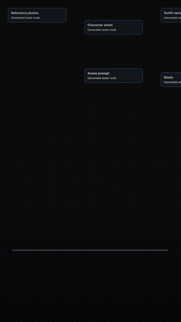

# Clip Studio

**Give your AI assistant a long video, or a link to a web page, and get back short, finished videos that are ready to post.**

No video skills needed. You say what you want in plain words. It does the editing and shows you the result.

<p align="center">
  
</p>

## What can it make?

| You say | You get |
|---|---|
| "Pull the best clips out of my podcast." | 8 to 12 short clips, each starting on its strongest line, with captions |
| "Make a 60-second highlight from this webinar." | One tight highlight video or teaser |
| "Take the ums and long pauses out." | A cleaned-up version of the whole recording |
| "Make this work for Reels and LinkedIn." | The same video in the right shape for each place |
| "Add captions." | Captions that light up as each word is spoken, plus a subtitle file |
| "Make a behind-the-scenes reel from this project link." | A short "how it was made" video, recorded from the page for you |

It works on podcasts, interviews, livestreams, webinars, talks, lectures, tutorials, screen demos, vlogs and events.

## See it

**A finished clip.** A hook line, a name tag, captions that follow the words, a progress bar and an end card. All of it is switchable, and it takes your colours and fonts.

<p align="center">
  
</p>

**A reel from a link.** Paste the link to a project page or canvas. Clip Studio opens it in the background (your screen and mouse stay yours), pans and zooms through it, and turns that into a reel with a label for every step.

<p align="center">
  
</p>

<sub>Both examples use made-up demo content.</sub>

## Get started

You need a **Mac** and an **AI coding assistant** such as [Claude Code](https://claude.com/claude-code), Codex, Cursor or Gemini CLI. The assistant does the work; you just talk to it.

**1. Download this folder.** Click the green **Code** button, then **Download ZIP**, and unzip it. (If you use Git: `git clone https://github.com/dj-kim-flora/clip-studio.git`.)

**2. Open the folder in your assistant** and say:

> Set this up for me.

It checks what your Mac needs, installs what it can, and tells you if there is anything you have to do yourself. This takes about 10 minutes the first time and is a one-off.

**3. Say what you have and what you want.** For example:

> Pull the best clips out of my podcast. It's at ~/Downloads/episode-12.mp4.

> Make a 45-second behind-the-scenes reel from this link: https://…

That's it. The assistant will:

1. **Read everything** and work out what it is. You don't have to explain.
2. **Ask up to four quick questions.** What is it for? Where will people watch (phone, feed, YouTube)? How much? What should it look like? Every question has a suggested answer, and "you decide" is always fine.
3. **Show you a plan**, for example a ranked list of the best moments with timestamps. Nothing is made until you say go.
4. **Make one test clip first** (for a set of clips) so you can approve the look.
5. **Make the rest** and put the files in the `deliverables/` folder, each with a subtitle file (`.srt`) and a thumbnail.

## Make it look like you

Send your **brand guidelines** (a PDF, a link, colours, fonts, a logo) or **a video whose look you like**. The assistant copies the style: colours, type, captions, end card. With neither, it uses a clean neutral look. You can restyle any time:

> Make it warmer. Bigger captions. Use my logo at the end.

## Give feedback in plain words

> Shorter. Punchier. Start with the pricing question instead. That part is boring. Another one just like clip 3.

You never need video terms. The assistant translates.

## Good to know

- **Your original recording is never changed.** Nothing is uploaded, posted or published. You get files and you post them.
- **Everything runs on your Mac.** Transcription is done on your computer too (the first run downloads a speech model if your Mac needs one).
- **Nothing costs money** unless the assistant tells you the price first and you say yes.
- **Music, footage, fonts and logos** must be ones you are allowed to use. Music is only added if you give it a track.
- **Links to web pages:** the assistant only looks. It moves the pointer and scrolls; it never clicks buttons, types or changes anything. If the page needs a login, a window opens once and **you** sign in. Your password is never typed by the assistant. It will ask first if the page shows anything private.
- **If a moment isn't funny, striking or useful to the viewer, it gets cut.** That is the bar for every clip.

## What it needs

A Mac, Node 22 or newer, Python 3, and ffmpeg (`brew install node ffmpeg` covers both). Google Chrome is needed only for recording links. `setup.sh` checks all of this and installs the speech-to-text part. Run `bash check.sh` any time to see what's ready.

## Honest status

- Tested end to end on generated recordings: cutting, captions, 9:16 / 4:5 / 1:1 / 16:9 exports, loudness, and the link-to-reel recorder on a demo canvas.
- Speech-to-text, face-following crops and downloading from video sites depend on your Mac and optional tools, so check your first real recording's result before sharing it.
- Link recording has not been tried against every site. Apps that move their canvas in unusual ways may need a hint from you.

---

## For people who like details

- **Agents:** [AGENTS.md](AGENTS.md) and [SKILL.md](SKILL.md) are the instructions the assistant follows; the playbook is in `skill/references/` (start with `intake.md`).
- **Plain-language guide:** [START-HERE.md](START-HERE.md).
- **Installing it as a skill:** `bash setup.sh` also links this folder into `~/.agents/skills`, `~/.claude/skills` and `~/.codex/skills` as `clip-studio`, so your assistant finds it from any folder. `bash setup.sh --no-links` skips that.

```
recording ─► prepare_source.py ─► transcript + audio + contact sheets
                  │
      farm.py (find the best moments)  or  a hand-written outline
                  │
     cuts/<name>.edl.json ─► build_cut.py ─► picture + leveled voice + captions
                  │
 export_clips.py = reframe + render + loudness + .srt + thumbnail ─► deliverables/

link ─► record_page.mjs (headless Chrome tour) ─► make_reel.py ─► export_clips.py ─► deliverables/
```

Common commands:

```sh
python3 tools/prepare_source.py "~/Downloads/episode.mp4" ep12          # read a recording
python3 tools/farm.py ep12 --min 20 --max 60 --top 20                   # list candidate clips
python3 tools/farm.py ep12 --emit-edls --pick 1,3,5 --prefix ep12       # turn picks into cut files
python3 tools/export_clips.py --all --platform reels                    # cut, reframe, render, level, export
python3 tools/brand_from_media.py source/brand/reference.mp4            # draft a look from a reference video
node tools/record_page.mjs --login "https://example.com/project"        # once: sign in yourself
node tools/record_page.mjs "https://example.com/project" demo --tour _work/demo-tour.json --clean --cursor
python3 tools/make_reel.py demo --title "How I made it" --seconds 30 --formats reels,widescreen --export
npm run studio                                                          # preview in Remotion Studio
```

Built on [Remotion](https://www.remotion.dev) (video), ffmpeg (audio and picture), and on-device speech-to-text (Apple SpeechAnalyzer on macOS 26+, otherwise mlx-whisper).

## Licence

MIT, see [LICENSE](LICENSE). The bundled Geist font is under the SIL Open Font License ([licenses/](licenses/)). Remotion has its own licence terms for company use: check <https://www.remotion.dev/license> before using this commercially in a company. Anything you add (footage, music, logos, fonts) stays yours and you are responsible for having the rights to it.
